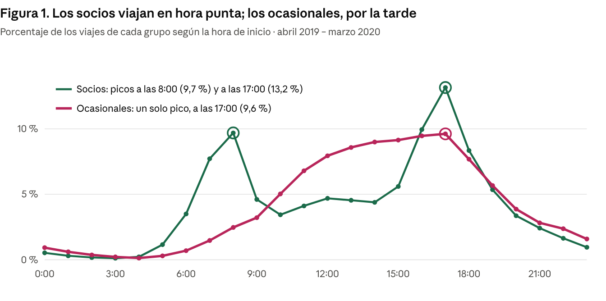

# Caso 1 · Cyclistic: socios vs. usuarios ocasionales

**Pregunta:** ¿En qué se diferencian los socios anuales y los usuarios ocasionales en el uso de las bicicletas?

## Datos
Viajes públicos de Divvy (Chicago), 2019 T2, T3, T4 y 2020 T1: https://divvy-tripdata.s3.amazonaws.com/index.html

## Limpieza
- 3.879.822 viajes unidos a un mismo esquema → **3.874.095** finales.
- Quitados: viajes de la estación de pruebas HQ QR (3.767), con duración cero o negativa (13) y de más de 24 horas (1.947, analizados aparte en `perdidas.py`).

## Hallazgos principales
- Los ocasionales hacen viajes **más largos**: mediana de 25,7 min, contra 9,8 min de los socios.
- **43 %** de los viajes ocasionales son en fin de semana (socios: 19 %).
- El 55 % de los viajes ocasionales ocurre entre junio y agosto.
- Los ocasionales se concentran en estaciones turísticas (Streeter Dr & Grand Ave, Millennium Park).
- Viajes de más de 24 h: 77 % son de usuarios ocasionales.



## Recomendaciones
1. Ofrecer una membresía de fin de semana o de verano como paso intermedio hacia la anual.
2. Hacer campañas en las estaciones del lago, de mayo a septiembre y en tardes de fin de semana.
3. Mostrar el ahorro al terminar los viajes largos, comparando lo pagado con el precio de socio.
4. Enviar un aviso automático al cumplir 24 horas de viaje.

**Limitaciones:** los datos no traen identificador de usuario ni precios, y marzo de 2020 ya refleja el inicio de la pandemia.

## Cómo ejecutar
```
python codigo/cyclistic_analisis.py <carpeta_csv_divvy> resultados
python codigo/perdidas.py <carpeta_csv_divvy>
```

## Fuentes y créditos
- Datos: Divvy System Data, puestos a disposición por Motivate International Inc. bajo su licencia de datos.
- Caso de estudio planteado por el Certificado de Análisis de Datos de Google (Coursera).

📄 [Informe técnico (PDF)](Informe_tecnico_Cyclistic.pdf)
