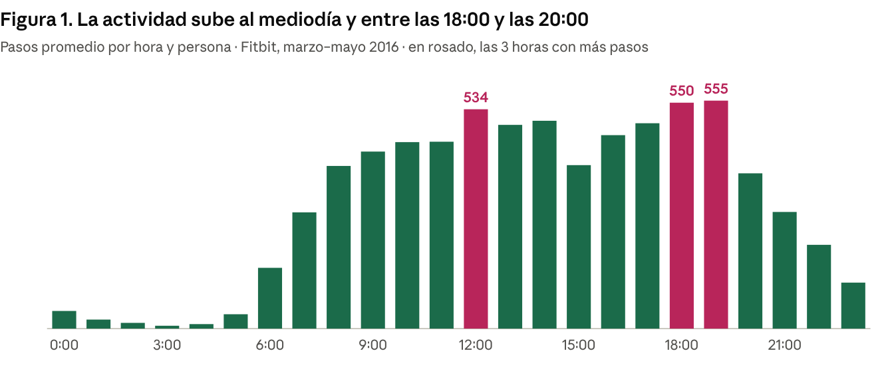

# Caso 2 · Bellabeat: tendencias de uso de dispositivos inteligentes

**Pregunta:** ¿Cómo usan las personas sus dispositivos inteligentes y qué significa eso para la app, Leaf, Time, Spring y la membresía de Bellabeat?

## Datos
- FitBit Fitness Tracker Data (Kaggle, CC0): 35 usuarios, 12 mar – 12 may 2016.
- Sleep Health and Lifestyle Dataset (Kaggle) y Gym Members Exercise Dataset (Kaggle), para comparar por sexo. Probablemente son datos sintéticos, así que se usan solo como referencia.

## Hallazgos principales
- 8.097 pasos diarios en promedio; solo el 34 % de los días llega a 10.000.
- El 80 % del tiempo registrado es sedentario.
- El 73 % de los usuarios registra sueño, pero solo el 24 % registra peso.
- El 44 % de las noches tiene menos de 7 horas de sueño.
- En los datos complementarios, comparando dentro de cada grupo de edad, aparecen diferencias de sueño y estrés entre hombres y mujeres.



## Recomendaciones por producto
- **App:** registros automáticos y un resumen semanal que muestre juntos el estrés y el sueño.
- **Leaf:** alertas para moverse a media mañana y media tarde, con una meta inicial de 7.500 pasos.
- **Time:** cómodo para dormir con él y un recordatorio para acostarse a la misma hora.
- **Spring:** recordatorios de hidratación a las 12:00, 18:00 y 19:00.
- **Membresía:** planes de sueño y estrés con un mes de prueba.

**Limitaciones:** FitBit tiene solo 35 personas de 2016 y no informa sexo ni edad; los datos por sexo parecen sintéticos. Conviene repetir el análisis con datos de clientas de Bellabeat.

## Cómo ejecutar
```
python codigo/bellabeat_analisis.py <carpeta_fitbit> resultados <sleep_health.csv> <gym_members_exercise_tracking.csv>
```

## Fuentes y créditos
- FitBit Fitness Tracker Data: Furberg, R., Brinton, J., Horvath, M. y Romanoff, A. (2016), Zenodo; publicado en Kaggle por Möbius (CC0).
- Sleep Health and Lifestyle Dataset y Gym Members Exercise Dataset, Kaggle.
- Caso de estudio planteado por el Certificado de Análisis de Datos de Google (Coursera).

📄 [Informe técnico (PDF)](Informe_tecnico_Bellabeat.pdf)
