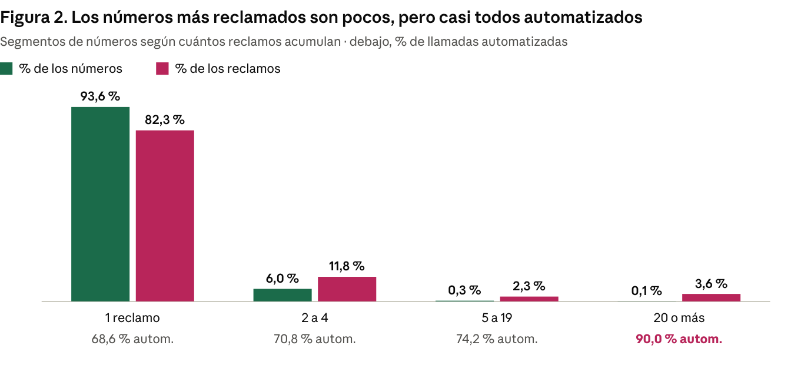

# Caso 3 · Llamadas comerciales no deseadas

**Pregunta:** ¿Qué patrones de llamada (cuándo, cómo y de qué tema) generan más reclamos? El caso está planteado para una compañía de telecomunicaciones en Chile que quiere reducir reclamos y cumplir la norma de prefijos 600/809.

## Datos
Reclamos públicos del registro Do Not Call de la FTC (EE.UU.), 14 sep – 5 oct 2026: https://www.ftc.gov/policy-notices/open-government/data-sets/do-not-call-data

En Chile no hay datos descargables de reclamos (SERNAC y SUBTEL solo publican resúmenes), por eso se usan como referencia los de EE.UU.

## Limpieza
192.325 filas → **178.227** reclamos. Se quitaron duplicados, llamadas con fecha posterior al reclamo y llamadas anteriores al período.

## Hallazgos principales
- El **70 %** de las llamadas reclamadas son automatizadas.
- El **75 %** ocurre entre 9:00 y 17:00, con el pico al mediodía; solo el 6,6 % es en fin de semana.
- El 82 % de las personas reclama el mismo día o el siguiente.
- El 94 % de los números aparece una sola vez; los 100 números con 20 o más reclamos son 90 % automatizados.



## Recomendaciones para la compañía
1. Menos llamadas automatizadas: solo a clientes que lo aceptaron; ofertas por mensaje o correo.
2. Un tope de llamadas por cliente y campañas espaciadas en vez de ráfagas.
3. Números identificables con prefijo 600/809, conforme a la norma chilena.
4. Evitar el mediodía, el horario con más reclamos.
5. Medir cada semana los reclamos por campaña.

**Limitaciones:** los datos son de EE.UU., no nombran empresas y no identifican a quien reclama. El cliente debería confirmar estos patrones con sus propios registros.

## Cómo ejecutar
```
python codigo/dnc_analisis.py <carpeta_csv_ftc> resultados
```

## Fuentes y créditos
- Federal Trade Commission (FTC), Do Not Call Reported Calls Data.
- Contexto chileno: The Clinic, SERNAC y las empresas con más llamadas molestas (2023); Pauta, SERNAC investiga incumplimientos de prefijos 809 y 600 (2026).
- Por privacidad, los resultados publicados no incluyen números de teléfono.

📄 [Informe técnico (PDF)](Informe_tecnico_Llamadas.pdf)
